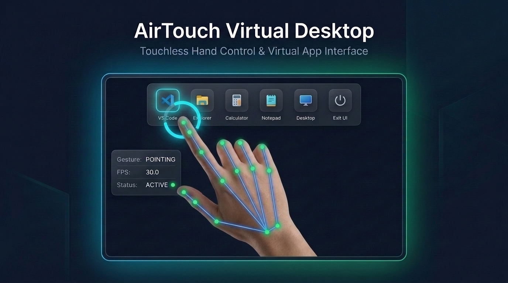
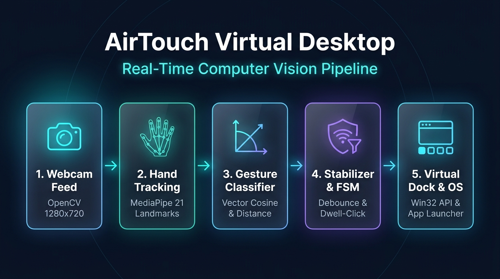

# 🖐️ AirTouch Virtual Desktop

**AirTouch Virtual Desktop** is a touchless human-computer interaction system that lets you control your Windows PC and launch applications through a **virtual air interface** using only your webcam and hand gestures. Built with **MediaPipe Hand Landmarker** and **OpenCV**, it combines real-time gesture recognition, adaptive stabilization, and an interactive on-screen **Virtual App Dock**.



---

## 📸 Architecture & Gesture Overview

| Supported Gestures | System Pipeline |
| :---: | :---: |
|  |  |

---

## 🚀 Key Features

- **Interactive Virtual Application Dock**: Use your index finger (`POINTING`) as an air cursor to hover over virtual buttons on screen (1.0s dwell-click) and launch Windows apps seamlessly:
  - 💻 **VS Code**
  - 📂 **File Explorer**
  - 🧮 **Calculator**
  - 📝 **Notepad**
  - 🖥️ **Show Desktop** (`Win + D`)
  - ❌ **Exit UI** (safely closes the AirTouch window)
- **Real-Time Hand Tracking**: Uses Google MediaPipe Hand Landmarker with 21 3D hand landmarks.
- **Clean Gesture Recognition**:
  - ✋ **Open Palm** (`OPEN_PALM`)
  - ✊ **Fist** (`FIST`)
  - ✌️ **Peace / Victory Sign** (`PEACE`)
  - ☝️ **Index Pointing** (`POINTING`) — drives the virtual air cursor
  - 👍 **Thumbs Up** (`THUMBS_UP`) — confirms system readiness
- **Adaptive Gesture Stabilization**: Per-gesture frame and timing thresholds prevent jitter and accidental triggers.
- **Glassmorphic HUD Overlay**: Displays real-time FPS, confidence score, stability progress, active controller state, and dwell progress rings.

---

## 📁 Project Structure

```
AirTouch-Virtual-Desktop/
├── docs/
│   └── images/                       # Project showcase & architecture visuals
├── models/
│   └── hand_landmarker.task          # MediaPipe Hand Landmarker task model
├── tests/
│   ├── test_gesture_integration.py   # Gesture state-machine integration tests
│   └── test_virtual_interface.py     # Classifier, dock UI, and command tests
├── vision_engine/
│   ├── __init__.py
│   ├── gesture_classifier.py         # Rule-based finger state & gesture classifier
│   ├── gesture_command_controller.py # Gesture sequence state machine
│   ├── gesture_recognition.py        # Landmark adapter
│   ├── hand_tracker.py               # MediaPipe video landmarker pipeline
│   └── virtual_interface.py          # Virtual Application Dock & glassmorphic HUD
├── main.py                           # Application entry point & webcam loop
├── windows_command_executor.py       # Win32 API & Windows application launcher
├── requirements.txt                  # Project dependencies
└── README.md
```

---

## 🛠️ Installation & Setup

### 1. Clone the Repository
```bash
git clone https://github.com/susu11234s7w7-arch/AirTouch-Virtual-Desktop.git
cd AirTouch-Virtual-Desktop
```

### 2. Create and Activate a Virtual Environment
```powershell
# Windows (PowerShell)
python -m venv .venv
.\.venv\Scripts\Activate.ps1
```

### 3. Install Dependencies
```bash
pip install -r requirements.txt
```

---

## 🎮 Running the Application

Start the virtual desktop controller:
```bash
python main.py
```

- Press **`q`**, **`ESC`**, or hover on **`Exit UI`** in the Virtual App Dock to exit.

### Running Tests
```bash
python -m tests.test_gesture_integration
python -m unittest tests/test_virtual_interface.py -v
```

---

## 📜 Supported Gestures & Virtual Controls

| Gesture / Interaction | Action Triggered |
|-----------------------|------------------|
| `OPEN_PALM` ➡️ `FIST` | **Minimize All Windows** (Show Desktop) |
| `PEACE` (armed) | **Launch Visual Studio Code** |
| `POINTING` (1.0s dwell on Dock) | **Launch Selected App** (`VS Code`, `Explorer`, `Calculator`, `Notepad`, `Desktop`, `Exit UI`) |
| `THUMBS_UP` | **Confirm System Ready** |
| `UNKNOWN` | **Re-arm Controller** for next gesture command |

---

## 📄 License
This project is open source and intended for educational, research, and productivity automation use.
